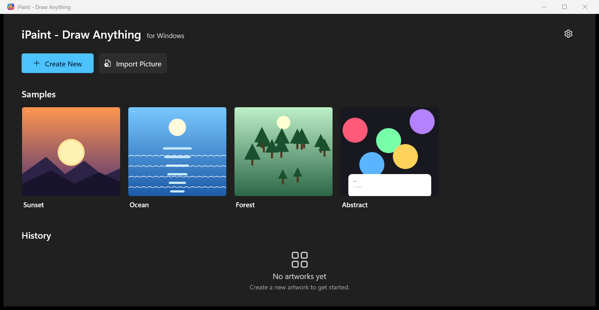

<div align="center">

# 🎨 iPaint - Draw Anything

### A fast, native WinUI 3 digital painting and sketching studio for Windows

**Sketch your ideas. Paint in responsive layers. Composite with blend modes. Zero install required.**

[](https://dotnet.microsoft.com/)
[](https://learn.microsoft.com/windows/apps/winui/)
[](https://learn.microsoft.com/windows/apps/)
[](LICENSE)
[](https://github.com/uponatime2019/iPaint/releases/latest)
[](https://github.com/uponatime2019/iPaint/actions/workflows/release.yml)

<br/>



</div>

---

## ⚡ Try It Now — Standalone & Zero Install

<div align="center">

### 👉 [**Download Latest Portable Release (Windows x64)**](https://github.com/uponatime2019/iPaint/releases/latest) 👈

</div>

1. Download **`iPaint-v*-win-x64.zip`** from the [latest release page](https://github.com/uponatime2019/iPaint/releases/latest).
2. Extract the `.zip` archive to any directory.
3. Launch **`iPaint.exe`**.

> **No installer, no administrative privileges, no Microsoft Store account, and no external runtime installations required.**
> The Windows App SDK runtime is fully bundled inside the package (`WindowsAppSDKSelfContained`), enabling true offline, portable execution.

---

## ✨ Features Overview

### 🖌️ Expressive Brush Engine
- **Stamp-Based Raster Engine**: Crisp, responsive stroke rendering with adjustable spacing, softness, and opacity.
- **Pressure Simulation**: Pressure-sensitive stroke dynamics with customizable minimum size ratio and taper settings.
- **Brush Library**: Built-in catalog including Dip Pen (Hard/Soft), Felt Tip Pen, Airbrush, Pencil, Watercolor, and Eraser presets.
- **Real-Time Stroke Stabilizer**: Intelligent stroke smoothing to eliminate jitters and create clean line art.

### 📑 Layer System & Non-Destructive Compositing
- **Multi-Layer Support**: Create, organize, duplicate, reorder, merge, and delete layers.
- **Advanced Blend Modes**: Full support for Normal, Multiply, Add, Screen, Overlay, and Linear Burn (Subtract).
- **Layer Protections**:
  - **Alpha Lock**: Restrict brush strokes to existing opaque pixel boundaries.
  - **Clipping Mask**: Confine upper layer content strictly to the silhouette of the base layer below.
- **Layer Transformations**: One-click horizontal/vertical flip, inversion, and layer clearing.
- **Opacity Control**: Granular 0–100% per-layer opacity sliders.

### 🎨 Color System & Selection
- **Interactive HSB Color Wheel**: Full 360° hue ring paired with an inner saturation/brightness selector.
- **Quick Eyedropper**: Sample any pixel from the canvas with pointer hold or gesture shortcut.
- **Paint Bucket (Flood Fill)**: Fast area coloring with adjustable tolerance and contiguous boundary detection.
- **Magic Wand & Selection Tools**: Boundary-aware selection masks for targeted edits.

### 🖼️ Artwork Gallery & Local Persistence
- **Zero-Cloud, Private-by-Design**: All artwork documents and settings remain strictly on your local machine (`%LOCALAPPDATA%\iPaint`).
- **History View**: Open, continue editing, or manage past artworks anytime from the home screen.
- **Sample Artworks**: Built-in starter artworks to explore and practice immediately.
- **Lossless PNG Export**: Export your completed artwork to standard PNG files ready to share.

---

## ⌨️ Controls & Shortcuts Reference

| Input / Gesture | Action |
|---|---|
| `Left Mouse Drag` / `Pen Tip` | Draw active brush stroke / apply current tool |
| `Ctrl + Mouse Wheel` | Smooth zoom in / zoom out (5% up to 3200%) |
| `Two-Finger Tap` | Undo last stroke (configurable in Settings) |
| `Three-Finger Tap` | Redo last undone stroke (configurable in Settings) |
| `Press & Hold Canvas` | Activate Quick Eyedropper to sample color |
| `Size Slider (-) / (+)` | Fine-tune brush diameter by 1 px increments |
| `Bottom Bar Buttons` | Toggle Tool Rail, Layer Panel, Color Wheel, and Quick Settings |

---

## 🏗️ Architecture & Technology Stack

- **UI Framework**: [WinUI 3](https://learn.microsoft.com/windows/apps/winui/) (Windows App SDK 2.4) with modern Fluent Design, Mica backdrop, and native desktop windowing.
- **Runtime**: [.NET 8](https://dotnet.microsoft.com/) (Self-Contained, Native x64 / ARM64 / x86).
- **Application Model**: Pure Unpackaged desktop application (`<WindowsPackageType>None</WindowsPackageType>`).
- **Raster Engine**: Custom C# software rasterizer with BGRA32 pixel buffer manipulation and compositing.
- **Serialization**: JSON-backed document headers and individual layer PNG storage via WinRT imaging codecs.

---

## 🛠️ Building & Running from Source

### Prerequisites
- **Operating System**: Windows 10 version 1809 (Build 17763) or Windows 11.
- **.NET SDK**: [.NET 8.0 SDK](https://dotnet.microsoft.com/download/dotnet/8.0).
- **IDE** (Optional): Visual Studio 2022 (version 17.10+) with the *.NET Desktop Development* workload.

### Build via Command Line

```powershell
# Clone the repository
git clone https://github.com/uponatime2019/iPaint.git
cd iPaint

# Restore and build Debug binary
dotnet build "iPaint.csproj" -p:Platform=x64

# Run the app locally
dotnet run --project "iPaint.csproj" -p:Platform=x64
```

### Produce a Standalone Release

```powershell
dotnet publish "iPaint.csproj" -c Release -p:Platform=x64 -o publish/iPaint_Portable
```

---

## 🗺️ Roadmap

- [ ] **Custom Brush Importer**: Support importing ABR (Photoshop) brush stamps and custom grain textures.
- [ ] **PSD Import/Export**: Open and save multi-layer Adobe Photoshop `.psd` files.
- [ ] **Vector Pen & Bézier Curve Tools**: Path-based vector line art with node editing.
- [ ] **Timelapse Recording**: Record drawing progress frame-by-frame and export to MP4/GIF.
- [ ] **Reference Window**: Floating mini reference image viewer while painting.
- [ ] **Multi-Monitor DPI & Canvas Rotation**: Enhanced freehand canvas angle rotation.

---

## 🤝 Contributing & Community

Contributions are warmly welcomed! Whether you want to fix a bug, optimize drawing engine performance, or suggest new features:

1. Check open [Issues](https://github.com/uponatime2019/iPaint/issues) or start a new [Discussion](https://github.com/uponatime2019/iPaint/discussions).
2. Fork the repository and create your feature branch:
   ```powershell
   git checkout -b feature/amazing-feature
   ```
3. Commit your changes and submit a Pull Request.

Please see our [CONTRIBUTING.md](CONTRIBUTING.md) guide for full development details.

---

## 📄 License

This project is licensed under the [MIT License](LICENSE) — free to use, modify, distribute, and integrate into personal and commercial projects.
